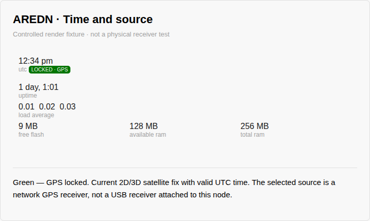
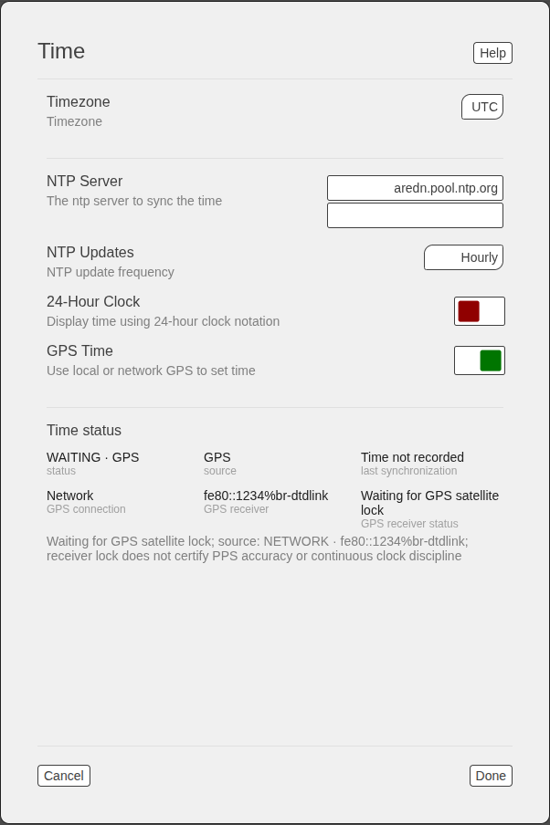
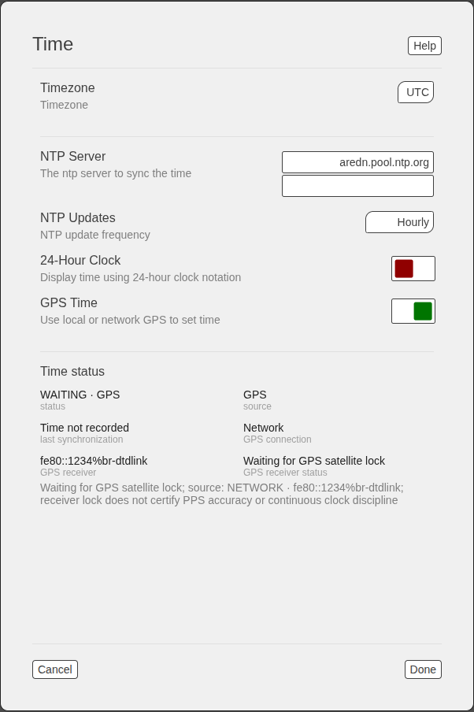
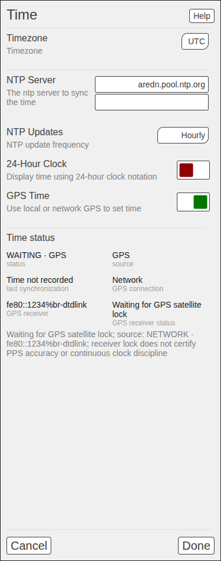

# GPS lock and clock-source status

The status page keeps basic time information up front. Detailed native evidence
is available in the **Time** popup, using the same value/caption visual pattern
as the neighbor popup.

## Compact status page

Only the clock and compact status badge are shown; there are no separate
`Source:` or receiver-detail lines. Hover text retains the source, selected
receiver endpoint, diagnostic reason, and recorded history. The same text is
exposed as the badge's accessible label.

| Badge | Evidence |
|---|---|
| `LOCKED · GPS` | Fresh receiver fix with valid UTC time |
| `WAITING · GPS` | Discovery, no satellite fix, or no valid receiver time |
| `ERROR · GPS` | Fresh receiver/source/connection failure |
| `SYNCED · NTP` | Matching recent native synchronization evidence |
| `UNSYNCED · NTP` | Native daemon callback reports an unsynchronized stratum |
| `STATUS UNKNOWN` | Old, invalid, missing, or unrecognized evidence |

When NTP last synchronized the clock and a selected GPS receiver has health data,
a second compact badge reports GPS LOCK/WAIT/ERROR/UNKNOWN. Its provenance and
reason are hover-only on the status page. With no selected GPS source, working
NTP does not generate an unrelated GPS alarm.

## Time popup

A **Time status** section sits below the existing settings and above the footer.
It uses three columns at desktop width and two on mobile, with values above
small captions, matching the neighbor-details convention.

- Status and recorded source: `GPS`, the successful NTP command's IP or hostname,
  or an explicit unknown source. A hostname is a valid alternative to an IP;
  no missing-IP warning, DNS resolution, or configured-server guess is added.
- Last synchronization/report UTC timestamp, observation age, NTP mode and
  daemon stratum, when validated native metadata supplies them. An unsynchronized
  daemon observation is a **last report**, not a successful synchronization.
- Selected GPS connection, local device or network endpoint, receiver health,
  expired-observation history and explanatory context.
- No clock query is forced to fill missing data. A GPS marker without a recorded
  timestamp is not used to invent the last synchronization time.

The read-only detail section refreshes independently every 30 seconds while the
page is visible. Refresh never replaces the settings controls, changes staged
values, or writes configuration. Existing PUT/DELETE handlers are unchanged.

## Controlled-render examples

These screenshots use native-template fixtures, not live receiver measurements.








## Evidence and preservation

GPS lock is receiver health, not certification of PPS accuracy or continuous
clock discipline. NTP evidence describes an observed native synchronization,
not a receiver lock. A recorded pool hostname identifies the command target,
not a resolved peer. Standard BusyBox callbacks expose stratum, not the peer.

- The page and popup read RAM caches only, without GPSD/NTP connections,
  discovery, USB scans, or package queries. Each render uses one native-marker
  snapshot. GPS-only views do not read/stat NTP metadata.
- GPS health expires after 90 seconds. Expired/invalid data becomes unknown,
  not a current receiver fault. Fresh faults remain ERROR. Historical reason
  and observation age remain available in the popup and hover text.
- One-shot NTP evidence becomes historical after 24 hours; daemon evidence
  after 15 minutes. Mismatched/future records cannot establish a source or
  synchronization. Old errors are not presented as current faults or successes.
- Existing GPS clock/location synchronization body, source discovery, marker
  behavior and ten-minute cadence are preserved. Observer failures cannot
  interrupt native synchronization, including when display observation is off.
- GPS/NTP cache writers publish atomically and never replace valid metadata with
  partial writes. Native NTP annotations are best-effort and cannot change
  synchronization success/failure, select a peer, or enable a daemon.
- Source, popup values and hover text are escaped. Long endpoints wrap within
  popup columns; explicit status words support the existing themes.

There is no USB hook, installation prompt, package/dependency/release change,
driver work, or replacement synchronization algorithm in this contribution.

## Isolated validation

```sh
python3 tests/gps-lock-run.py \
  --ucode /path/to/ucode --ucode-library /path/to/modules \
  --playwright-module /path/to/playwright-core
python3 tests/ntp-annotations.py
```

The default firmware baseline is pinned to
`3a7fdab83897ae2f9aebd42e052fe78ecac34a66`; runners accept explicit baseline
overrides. Clock/config/service writes are mocked, native sockets use private
loopback fixtures, and browser requests are intercepted. The real health and
time-popup templates, themes, controls and repository HTMX are exercised.

Coverage includes all six labels; recorded IPv4/IPv6/hostname/unknown sources;
historical, future, invalid and stale evidence; escaped hover and popup values;
independent GPS health while NTP is active; desktop/mobile two-/three-column
renders; popup placement; and simultaneous health/popup refreshes that preserve
staged settings. These are not a firmware build or physical-fault/reboot tests.
