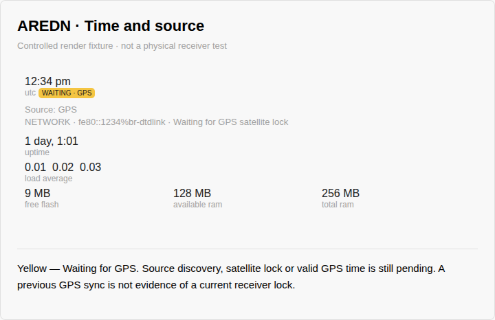
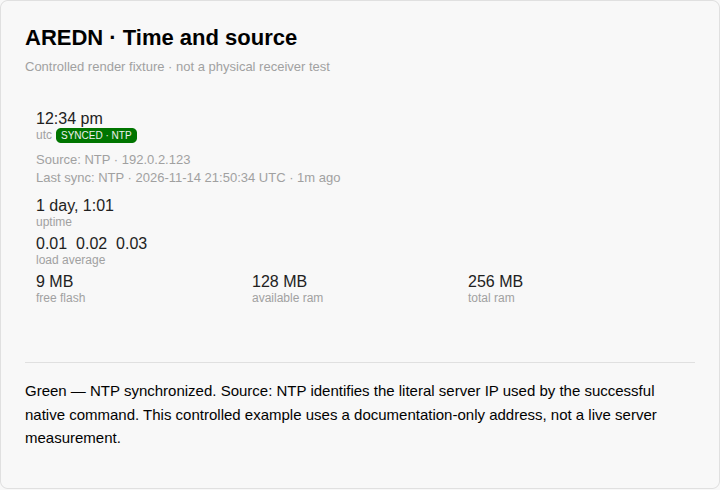
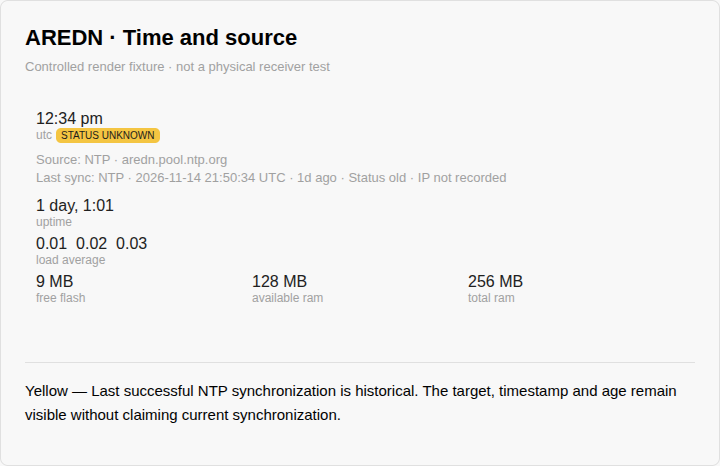

# GPS lock and clock-source status in the time area

This firmware GUI/status change makes receiver health and clock-source evidence
visible without treating them as the same thing.

| Indicator | Source line | Evidence |
|---|---|---|
| `LOCKED · GPS` | `Source: GPS` | Fresh receiver fix with valid UTC time |
| `WAITING · GPS` | `Source: GPS` | Discovery, no satellite fix, or no valid receiver time |
| `ERROR · GPS` | `Source: GPS` | Fresh observation of a missing source or failed receiver connection/data |
| `SYNCED · NTP` | `Source: NTP · <recorded IP/hostname>`, or peer unknown | Matching recent native synchronization evidence |
| `UNSYNCED · NTP` | `Source: NTP · Peer unknown` | Native daemon callback reports an unsynchronized stratum |
| `STATUS UNKNOWN` | Historical source where known, otherwise explicitly unknown | Old, invalid, missing or unrecognized evidence cannot establish current status |

The display uses exactly these six main labels. A **visible detail line** beneath
the status and source retains the last synchronization source and UTC timestamp
when recorded, observation age, expired-report explanation, or missing-evidence
reason. These diagnostics do not require hovering over a tooltip. An expired
unsynchronized NTP report is identified as a **last report**, never relabeled a
successful synchronization. No synchronization marker means no synchronization
is recorded, not proof that the clock is currently wrong.

GPS LOCAL/NETWORK provenance and the selected receiver device/endpoint appear
in the visible detail line. A numeric NTP command target appears directly, for
example `Source: NTP · 192.0.2.123` or `Source: NTP · 2001:db8::123`.
When the successful target is a hostname, the hostname is retained and the
detail line says **IP not recorded**. The native one-shot result does not expose
its resolved peer, and the daemon callback exposes no peer at all. The GUI
does not perform DNS lookups or claim that a later DNS answer identifies the
server which synchronized the clock.

GPS lock is receiver health, not proof of PPS accuracy or continuous clock
discipline. NTP evidence describes an observed native synchronization, not a GPS
lock. A pool hostname is the successful command target; no resolved IP is
invented. A configured server list is not evidence of the server actually used.
Standard BusyBox callbacks expose stratum, not the selected peer.

When NTP last synchronized the clock and a selected GPS receiver also has health
data, a separate badge reports that receiver's lock. With no selected GPS source,
working NTP does not produce an unrelated GPS alarm.
The separate receiver badge uses `GPS UNKNOWN` for an expired observation and
also has a visible receiver-detail line; healthy NTP remains `SYNCED · NTP`.

## Controlled-render examples

These screenshots use native-template fixtures, not live receiver measurements.






## Display support

- The existing GPS manager publishes a bounded health observation every 30 seconds
  while GPS Time is enabled. Receiver provenance comes from its selected local
  device or network endpoint, never a remote server's TPV device path.
- The native clock/location synchronization body and ten-minute cadence are
  retained, including native synchronization-marker ownership and cleanup.
  Observer failures cannot interrupt native work, and disabling health display
  does not change native source discovery/setup or synchronization scheduling.
- The page reads RAM caches only. It performs no GPSD/NTP connection, discovery,
  USB scan, or package query. It reuses the existing authenticated HTMX refresh
  and time-settings interaction; public read-only views require reload.
  Both badges share one native-marker snapshot. GPS-only views do not read or
  stat NTP metadata.
- GPS health expires after 90 seconds. Discovery retries retain the native
  ten-minute interval; the display can therefore report stale data between retries.
  Expired or invalid observation metadata becomes `STATUS UNKNOWN`, not a
  receiver fault. Fresh receiver failures remain `ERROR · GPS`. The last receiver
  report and its age remain visible when the observation has expired.
  Partial cache writes are never published; failed temporary files are removed.
- Native successful NTP paths gain best-effort metadata annotations. Annotation
  failure does not change the native synchronization result. The observer does
  not set the clock, select a peer, or enable a daemon.
- NTP metadata uses writer-specific temporary files and atomic rename. Marker
  mtime and monotonic timestamps reject mismatched/future records. One-shot
  evidence becomes historical after 24 hours; daemon evidence after 15 minutes.
  Expired daemon reports become `STATUS UNKNOWN`, not a continuing current alarm
  or a claimed current synchronization; their history remains in the detail line.
  Daemon records never certify a peer absent from the native callback.
- Source text, visible details and tooltips are escaped. Explicit state words support all themes;
  long source endpoints wrap.

There is no USB-detection hook, installation prompt, package/dependency/release
change, driver change, or replacement synchronization algorithm in this patch.

## Isolated validation

```sh
python3 tests/gps-lock-run.py \
  --ucode /path/to/ucode --ucode-library /path/to/modules \
  --playwright-module /path/to/playwright-core
python3 tests/ntp-annotations.py
```

The default baseline is pinned to firmware revision
`3a7fdab83897ae2f9aebd42e052fe78ecac34a66`; both runners accept
`--baseline-ref` for explicit rebasing. Clock/config/service writes are mocked.
Loopback GPSD fixtures use private ephemeral ports, and browser requests are
intercepted. Tests exercise real repository templates, themes, and HTMX resources.
These checks do not qualify physical receiver faults, reboots, or a firmware build.

Regression coverage includes all six main labels, explicit GPS/NTP source types,
recorded IPv4/IPv6 targets, honest hostname/unknown-peer fallbacks, historical GPS/NTP markers,
missing or unrecognized synchronization sources, stale GPS success/failure,
future and invalid receiver observations, visible detail-line content and
escaping, and independent GPS LOCK/WAIT/ERROR/UNKNOWN badges while NTP is in use.
The runners also retain the observer-failure, cache-publication, native-cadence,
source-attribution and single-snapshot checks.

The six-label/detail-line/source revision passed 207 candidate native checks plus
10 baseline manager checks, 7 private-loopback GPSD cases, 384 browser
authentication/theme/size/state combinations, and 6 baseline / 6 candidate
NTP-script cases. Three HTMX refreshes verified WAITING, ERROR and UNKNOWN
transitions with visible detail updates; the time-settings interaction remained
intact and there were no browser page errors.
